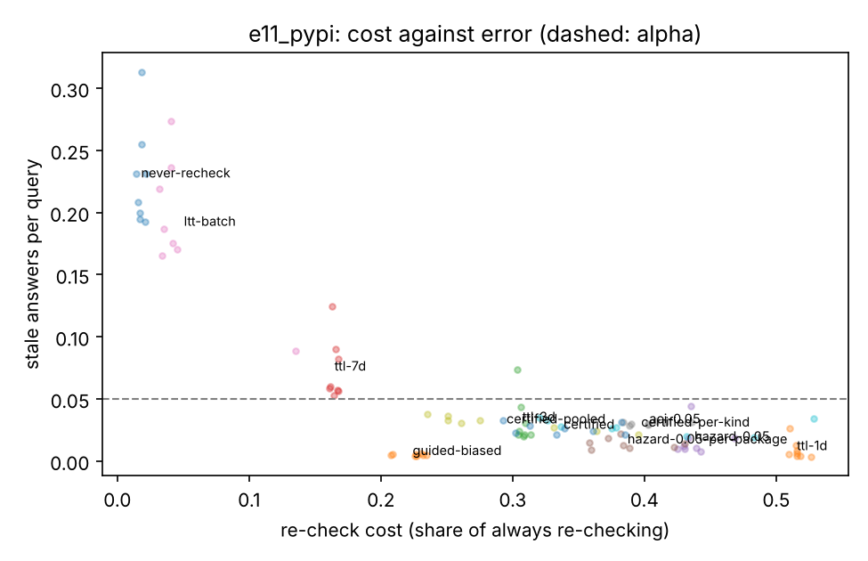
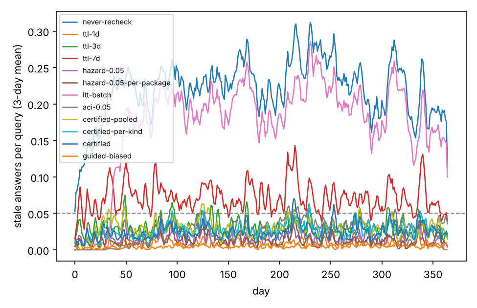

# e11_pypi

96 runs. Errors are stale or wrong answers per query after the burn-in; cost is re-checks as a share of always re-checking.

| Arm | Seeds | Error (mean) | Error (95th pct) | Seeds over alpha | Seeds with a group over alpha | Cost vs always | Served from memory |
|---|---|---|---|---|---|---|---|
| never-recheck | 8 | 0.2283 | 0.2928 | 1.00 | 1.00 | 0.018 | 0.992 |
| ttl-1d | 8 | 0.0088 | 0.0216 | 0.00 | 0.00 | 0.516 | 0.514 |
| ttl-3d | 8 | 0.0320 | 0.0628 | 0.12 | 1.00 | 0.307 | 0.713 |
| ttl-7d | 8 | 0.0728 | 0.1124 | 1.00 | 1.00 | 0.165 | 0.849 |
| hazard-0.05 | 8 | 0.0163 | 0.0352 | 0.00 | 0.75 | 0.438 | 0.613 |
| hazard-0.05-per-package | 8 | 0.0141 | 0.0207 | 0.00 | 0.00 | 0.387 | 0.664 |
| ltt-batch | 8 | 0.1893 | 0.2606 | 1.00 | 1.00 | 0.051 | 0.966 |
| aci-0.05 | 8 | 0.0304 | 0.0318 | 0.00 | 0.00 | 0.404 | 0.685 |
| certified-pooled | 8 | 0.0303 | 0.0373 | 0.00 | 0.50 | 0.295 | 0.739 |
| certified-per-kind | 8 | 0.0278 | 0.0348 | 0.00 | 0.00 | 0.398 | 0.653 |
| certified | 8 | 0.0260 | 0.0320 | 0.00 | 0.00 | 0.339 | 0.713 |
| guided-biased | 8 | 0.0049 | 0.0061 | 0.00 | 0.00 | 0.224 | 0.785 |

Error by provenance class (mean over seeds):

| Arm | delegated | inferred | notified | observed |
|---|---|---|---|---|
| never-recheck | 0.2130 | 0.3531 | 0.3731 | 0.1873 |
| ttl-1d | 0.0060 | 0.0112 | 0.0101 | 0.0089 |
| ttl-3d | 0.0402 | 0.0511 | 0.1377 | 0.0265 |
| ttl-7d | 0.0832 | 0.1166 | 0.2274 | 0.0565 |
| hazard-0.05 | 0.0195 | 0.0052 | 0.0746 | 0.0165 |
| hazard-0.05-per-package | 0.0230 | 0.0073 | 0.0221 | 0.0130 |
| ltt-batch | 0.1902 | 0.2323 | 0.2989 | 0.1516 |
| aci-0.05 | 0.0001 | 0.0000 | 0.0000 | 0.0373 |
| certified-pooled | 0.0560 | 0.0332 | 0.0448 | 0.0228 |
| certified-per-kind | 0.0076 | 0.0122 | 0.0000 | 0.0322 |
| certified | 0.0168 | 0.0112 | 0.0000 | 0.0294 |
| guided-biased | 0.0155 | 0.0070 | 0.0000 | 0.0027 |

Certification by group (share of seeds certified / median day of first certificate / alarms per run):

| Arm | all | delegated | inferred | notified | observed | stated |
|---|---|---|---|---|---|---|
| certified-pooled | 1.00 / 2.1 / 2.0 |  |  |  |  |  |
| certified-per-kind |  | 1.00 / 36.7 / 0.0 | 1.00 / 27.8 / 0.0 | 0.00 / - / 0.0 | 1.00 / 3.1 / 1.9 | 0.00 / - / 0.0 |
| certified |  | 1.00 / 35.5 / 0.0 | 1.00 / 27.5 / 0.0 | 0.00 / - / 0.0 | 1.00 / 3.1 / 1.2 | 0.00 / - / 0.0 |
| guided-biased |  | 1.00 / 33.1 / 0.0 | 1.00 / 28.1 / 0.0 | 0.00 / - / 0.0 | 1.00 / 3.1 / 0.0 | 0.00 / - / 0.0 |

