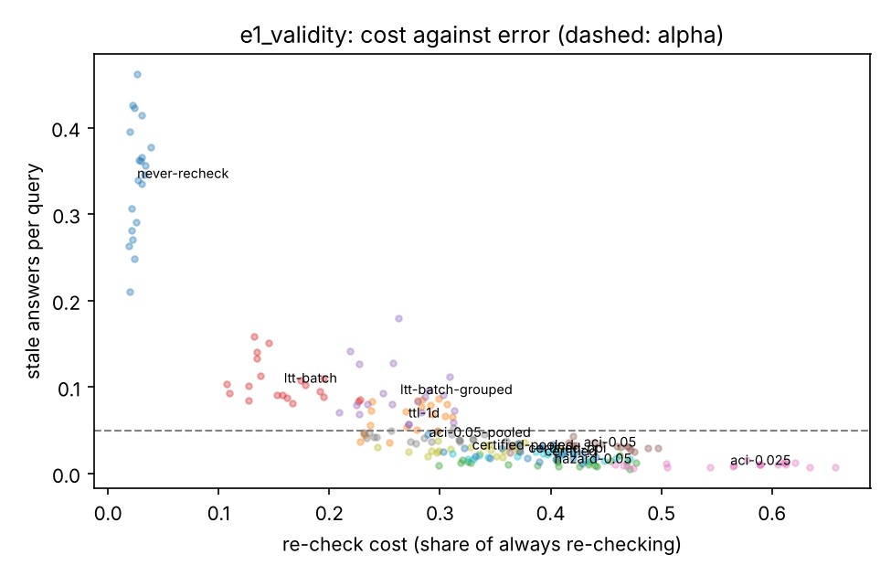
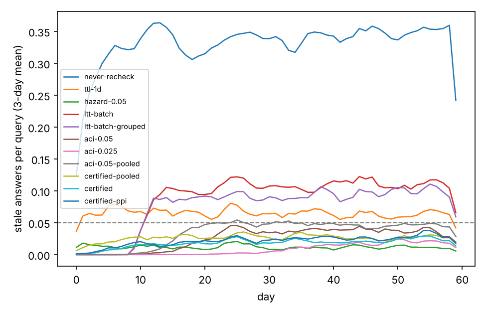

# e1_validity

220 runs. Errors are stale or wrong answers per query after the burn-in; cost is re-checks as a share of always re-checking.

| Arm | Seeds | Error (mean) | Error (95th pct) | Seeds over alpha | Seeds with a group over alpha | Cost vs always | Served from memory |
|---|---|---|---|---|---|---|---|
| never-recheck | 20 | 0.3417 | 0.4277 | 1.00 | 1.00 | 0.026 | 0.984 |
| ttl-1d | 20 | 0.0647 | 0.0851 | 0.75 | 1.00 | 0.271 | 0.748 |
| hazard-0.05 | 20 | 0.0118 | 0.0160 | 0.00 | 0.15 | 0.403 | 0.600 |
| ltt-batch | 20 | 0.1050 | 0.1512 | 1.00 | 1.00 | 0.159 | 0.857 |
| ltt-batch-grouped | 20 | 0.0918 | 0.1439 | 1.00 | 1.00 | 0.264 | 0.782 |
| aci-0.05 | 20 | 0.0310 | 0.0358 | 0.00 | 0.05 | 0.430 | 0.619 |
| aci-0.025 | 20 | 0.0099 | 0.0130 | 0.00 | 0.00 | 0.562 | 0.456 |
| aci-0.05-pooled | 20 | 0.0422 | 0.0496 | 0.05 | 0.95 | 0.290 | 0.721 |
| certified-pooled | 20 | 0.0277 | 0.0360 | 0.00 | 0.75 | 0.329 | 0.681 |
| certified | 20 | 0.0205 | 0.0258 | 0.00 | 0.00 | 0.394 | 0.629 |
| certified-ppi | 20 | 0.0242 | 0.0350 | 0.00 | 0.05 | 0.380 | 0.649 |

Error by provenance class (mean over seeds):

| Arm | delegated | inferred | notified | observed | stated |
|---|---|---|---|---|---|
| never-recheck | 0.4217 | 0.4354 | 0.4432 | 0.3144 | 0.1025 |
| ttl-1d | 0.0519 | 0.1052 | 0.0810 | 0.0613 | 0.0159 |
| hazard-0.05 | 0.0179 | 0.0034 | 0.0041 | 0.0114 | 0.0314 |
| ltt-batch | 0.1388 | 0.0854 | 0.0734 | 0.1111 | 0.0774 |
| ltt-batch-grouped | 0.0000 | 0.0081 | 0.0000 | 0.1141 | 0.0000 |
| aci-0.05 | 0.0000 | 0.0000 | 0.0000 | 0.0388 | 0.0000 |
| aci-0.025 | 0.0000 | 0.0000 | 0.0000 | 0.0124 | 0.0000 |
| aci-0.05-pooled | 0.0806 | 0.0482 | 0.0493 | 0.0387 | 0.0483 |
| certified-pooled | 0.0573 | 0.0238 | 0.0187 | 0.0268 | 0.0378 |
| certified | 0.0038 | 0.0068 | 0.0000 | 0.0244 | 0.0037 |
| certified-ppi | 0.0017 | 0.0061 | 0.0000 | 0.0293 | 0.0030 |

Certification by group (share of seeds certified / median day of first certificate / alarms per run):

| Arm | all | delegated | inferred | notified | observed | stated |
|---|---|---|---|---|---|---|
| certified-pooled | 1.00 / 0.7 / 0.8 |  |  |  |  |  |
| certified |  | 1.00 / 30.4 / 0.0 | 1.00 / 6.2 / 0.0 | 0.00 / - / 0.0 | 1.00 / 1.0 / 0.6 | 1.00 / 50.4 / 0.0 |
| certified-ppi |  | 1.00 / 30.9 / 0.0 | 1.00 / 6.2 / 0.0 | 0.00 / - / 0.0 | 1.00 / 1.0 / 0.0 | 1.00 / 50.4 / 0.0 |

