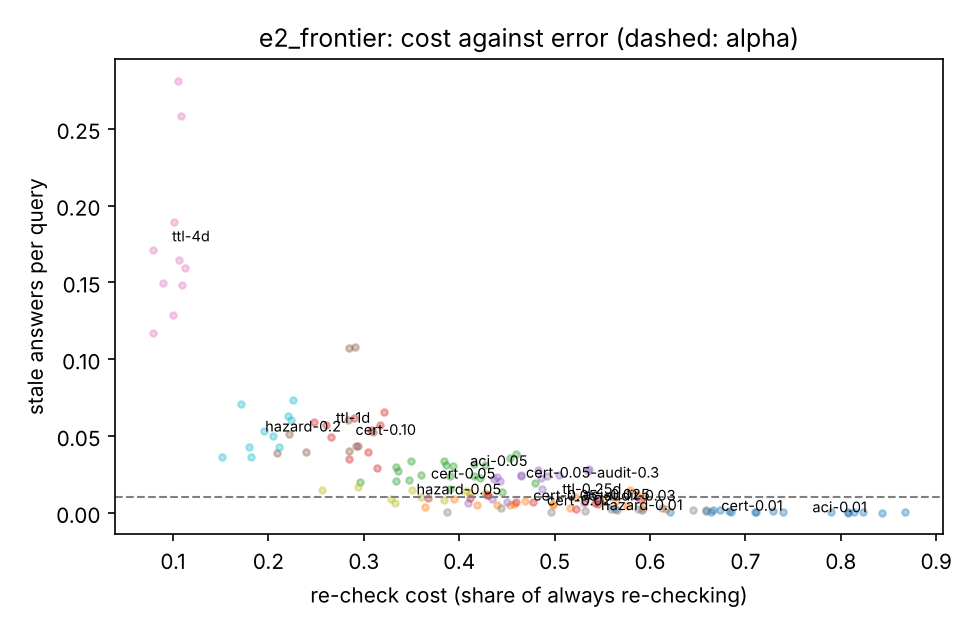
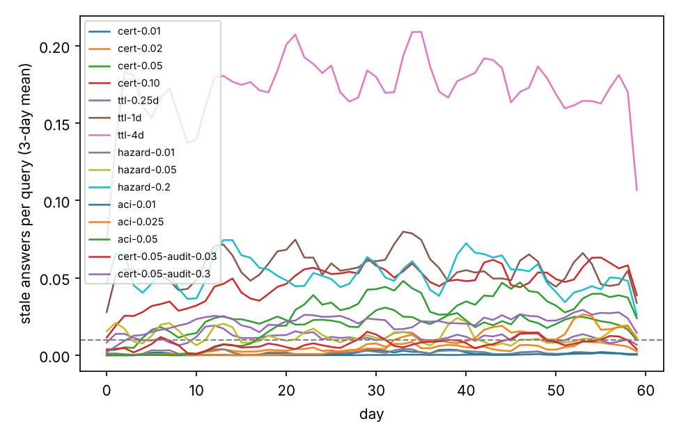

# e2_frontier

150 runs. Errors are stale or wrong answers per query after the burn-in; cost is re-checks as a share of always re-checking.

| Arm | Seeds | Error (mean) | Error (95th pct) | Seeds over alpha | Seeds with a group over alpha | Cost vs always | Served from memory |
|---|---|---|---|---|---|---|---|
| cert-0.01 | 10 | 0.0013 | 0.0023 | 0.00 | 0.00 | 0.675 | 0.320 |
| cert-0.02 | 10 | 0.0048 | 0.0082 | 0.00 | 0.00 | 0.492 | 0.509 |
| cert-0.05 | 10 | 0.0223 | 0.0304 | 0.00 | 0.00 | 0.370 | 0.654 |
| cert-0.10 | 10 | 0.0507 | 0.0637 | 0.00 | 0.00 | 0.291 | 0.740 |
| ttl-0.25d | 10 | 0.0122 | 0.0279 | 0.00 | 0.10 | 0.508 | 0.520 |
| ttl-1d | 10 | 0.0585 | 0.1076 | 0.50 | 1.00 | 0.271 | 0.748 |
| ttl-4d | 10 | 0.1767 | 0.2708 | 1.00 | 1.00 | 0.099 | 0.913 |
| hazard-0.01 | 10 | 0.0017 | 0.0029 | 0.00 | 0.00 | 0.549 | 0.444 |
| hazard-0.05 | 10 | 0.0120 | 0.0159 | 0.00 | 0.10 | 0.355 | 0.651 |
| hazard-0.2 | 10 | 0.0529 | 0.0722 | 0.50 | 1.00 | 0.197 | 0.814 |
| aci-0.01 | 10 | 0.0003 | 0.0006 | 0.00 | 0.00 | 0.770 | 0.219 |
| aci-0.025 | 10 | 0.0086 | 0.0136 | 0.00 | 0.00 | 0.530 | 0.489 |
| aci-0.05 | 10 | 0.0304 | 0.0371 | 0.00 | 0.00 | 0.411 | 0.638 |
| cert-0.05-audit-0.03 | 10 | 0.0079 | 0.0116 | 0.00 | 0.00 | 0.478 | 0.524 |
| cert-0.05-audit-0.3 | 10 | 0.0228 | 0.0264 | 0.00 | 0.00 | 0.470 | 0.547 |

Error by provenance class (mean over seeds):

| Arm | delegated | inferred | notified | observed | stated |
|---|---|---|---|---|---|
| cert-0.01 | 0.0000 | 0.0006 | 0.0000 | 0.0015 | 0.0000 |
| cert-0.02 | 0.0000 | 0.0028 | 0.0000 | 0.0055 | 0.0000 |
| cert-0.05 | 0.0041 | 0.0074 | 0.0000 | 0.0268 | 0.0000 |
| cert-0.10 | 0.0121 | 0.0217 | 0.0000 | 0.0613 | 0.0110 |
| ttl-0.25d | 0.0022 | 0.0168 | 0.0215 | 0.0122 | 0.0000 |
| ttl-1d | 0.0333 | 0.1143 | 0.0993 | 0.0528 | 0.0012 |
| ttl-4d | 0.2060 | 0.3253 | 0.2742 | 0.1542 | 0.0101 |
| hazard-0.01 | 0.0007 | 0.0002 | 0.0039 | 0.0020 | 0.0023 |
| hazard-0.05 | 0.0119 | 0.0051 | 0.0214 | 0.0134 | 0.0130 |
| hazard-0.2 | 0.0467 | 0.0464 | 0.0564 | 0.0643 | 0.0292 |
| aci-0.01 | 0.0000 | 0.0000 | 0.0000 | 0.0004 | 0.0000 |
| aci-0.025 | 0.0000 | 0.0000 | 0.0000 | 0.0107 | 0.0000 |
| aci-0.05 | 0.0000 | 0.0000 | 0.0000 | 0.0381 | 0.0000 |
| cert-0.05-audit-0.03 | 0.0023 | 0.0039 | 0.0000 | 0.0092 | 0.0043 |
| cert-0.05-audit-0.3 | 0.0055 | 0.0152 | 0.0000 | 0.0260 | 0.0000 |

Certification by group (share of seeds certified / median day of first certificate / alarms per run):

| Arm | delegated | inferred | notified | observed | stated |
|---|---|---|---|---|---|
| cert-0.01 | 0.00 / - / 0.0 | 1.00 / 25.4 / 0.1 | 0.00 / - / 0.0 | 1.00 / 4.1 / 1.4 | 0.00 / - / 0.0 |
| cert-0.02 | 0.00 / - / 0.0 | 1.00 / 13.5 / 0.0 | 0.00 / - / 0.0 | 1.00 / 2.2 / 0.0 | 0.00 / - / 0.0 |
| cert-0.05 | 1.00 / 29.1 / 0.0 | 1.00 / 6.0 / 0.0 | 0.00 / - / 0.0 | 1.00 / 1.0 / 0.7 | 1.00 / 49.3 / 0.0 |
| cert-0.10 | 1.00 / 16.6 / 0.0 | 1.00 / 3.7 / 0.1 | 1.00 / 44.3 / 0.0 | 1.00 / 0.6 / 0.9 | 1.00 / 28.2 / 0.0 |
| cert-0.05-audit-0.03 | 1.00 / 31.6 / 0.0 | 1.00 / 6.0 / 0.1 | 0.00 / - / 0.0 | 1.00 / 1.0 / 2.4 | 1.00 / 49.2 / 0.0 |
| cert-0.05-audit-0.3 | 1.00 / 29.0 / 0.0 | 1.00 / 6.0 / 0.1 | 0.00 / - / 0.0 | 1.00 / 1.0 / 2.3 | 1.00 / 48.8 / 0.0 |

