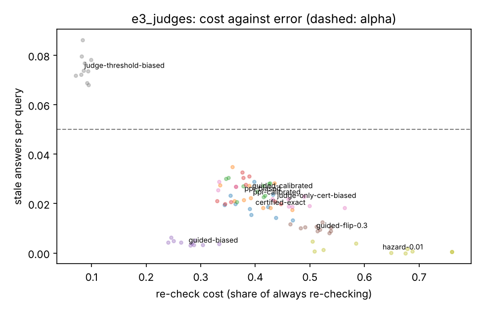
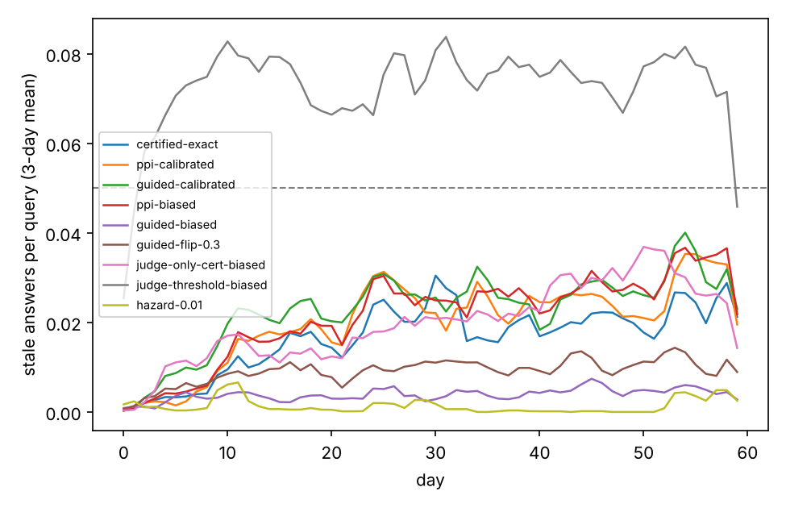

# e3_judges

90 runs. Errors are stale or wrong answers per query after the burn-in; cost is re-checks as a share of always re-checking.

| Arm | Seeds | Error (mean) | Error (95th pct) | Seeds over alpha | Seeds with a group over alpha | Cost vs always | Served from memory |
|---|---|---|---|---|---|---|---|
| certified-exact | 10 | 0.0195 | 0.0266 | 0.00 | 0.00 | 0.400 | 0.610 |
| ppi-calibrated | 10 | 0.0237 | 0.0319 | 0.00 | 0.00 | 0.396 | 0.618 |
| guided-calibrated | 10 | 0.0263 | 0.0303 | 0.00 | 0.00 | 0.394 | 0.628 |
| ppi-biased | 10 | 0.0252 | 0.0320 | 0.00 | 0.00 | 0.380 | 0.637 |
| guided-biased | 10 | 0.0042 | 0.0058 | 0.00 | 0.00 | 0.278 | 0.726 |
| guided-flip-0.3 | 10 | 0.0101 | 0.0121 | 0.00 | 0.00 | 0.512 | 0.507 |
| judge-only-cert-biased | 10 | 0.0223 | 0.0280 | 0.00 | 0.90 | 0.440 | 0.556 |
| judge-threshold-biased | 10 | 0.0749 | 0.0833 | 1.00 | 1.00 | 0.087 | 0.929 |
| hazard-0.01 | 10 | 0.0014 | 0.0044 | 0.00 | 0.00 | 0.633 | 0.291 |

Error by provenance class (mean over seeds):

| Arm | delegated | inferred | notified | observed | stated |
|---|---|---|---|---|---|
| certified-exact | 0.0017 | 0.0042 | 0.0000 | 0.0244 | 0.0004 |
| ppi-calibrated | 0.0022 | 0.0037 | 0.0000 | 0.0300 | 0.0000 |
| guided-calibrated | 0.0022 | 0.0045 | 0.0000 | 0.0332 | 0.0004 |
| ppi-biased | 0.0023 | 0.0046 | 0.0000 | 0.0317 | 0.0000 |
| guided-biased | 0.0034 | 0.0068 | 0.0000 | 0.0041 | 0.0000 |
| guided-flip-0.3 | 0.0019 | 0.0056 | 0.0000 | 0.0121 | 0.0000 |
| judge-only-cert-biased | 0.1041 | 0.0128 | 0.0000 | 0.0156 | 0.0013 |
| judge-threshold-biased | 0.2361 | 0.0139 | 0.0099 | 0.0036 | 0.0012 |
| hazard-0.01 | 0.0006 | 0.0001 | 0.0000 | 0.0017 | 0.0036 |

Certification by group (share of seeds certified / median day of first certificate / alarms per run):

| Arm | delegated | inferred | notified | observed | stated |
|---|---|---|---|---|---|
| certified-exact | 1.00 / 13.6 / 0.0 | 1.00 / 6.2 / 0.0 | 0.00 / - / 0.0 | 1.00 / 1.0 / 0.2 | 0.90 / 57.7 / 0.0 |
| ppi-calibrated | 1.00 / 13.7 / 0.0 | 1.00 / 6.2 / 0.0 | 0.00 / - / 0.0 | 1.00 / 1.0 / 0.1 | 0.90 / 57.7 / 0.0 |
| guided-calibrated | 1.00 / 13.3 / 0.0 | 1.00 / 6.2 / 0.0 | 0.00 / - / 0.0 | 1.00 / 1.0 / 0.0 | 0.90 / 57.2 / 0.0 |
| ppi-biased | 1.00 / 13.6 / 0.0 | 1.00 / 6.2 / 0.0 | 0.00 / - / 0.0 | 1.00 / 1.0 / 0.0 | 0.90 / 57.7 / 0.0 |
| guided-biased | 1.00 / 11.6 / 0.0 | 1.00 / 6.2 / 0.0 | 0.00 / - / 0.0 | 1.00 / 1.0 / 0.0 | 0.90 / 55.8 / 0.0 |
| guided-flip-0.3 | 1.00 / 12.5 / 0.0 | 1.00 / 6.2 / 0.0 | 0.00 / - / 0.0 | 1.00 / 1.0 / 0.0 | 0.90 / 55.9 / 0.0 |
| judge-only-cert-biased | 1.00 / 13.3 / 0.1 | 1.00 / 6.2 / 0.2 | 0.00 / - / 0.0 | 1.00 / 1.0 / 4.6 | 0.90 / 56.2 / 0.0 |

