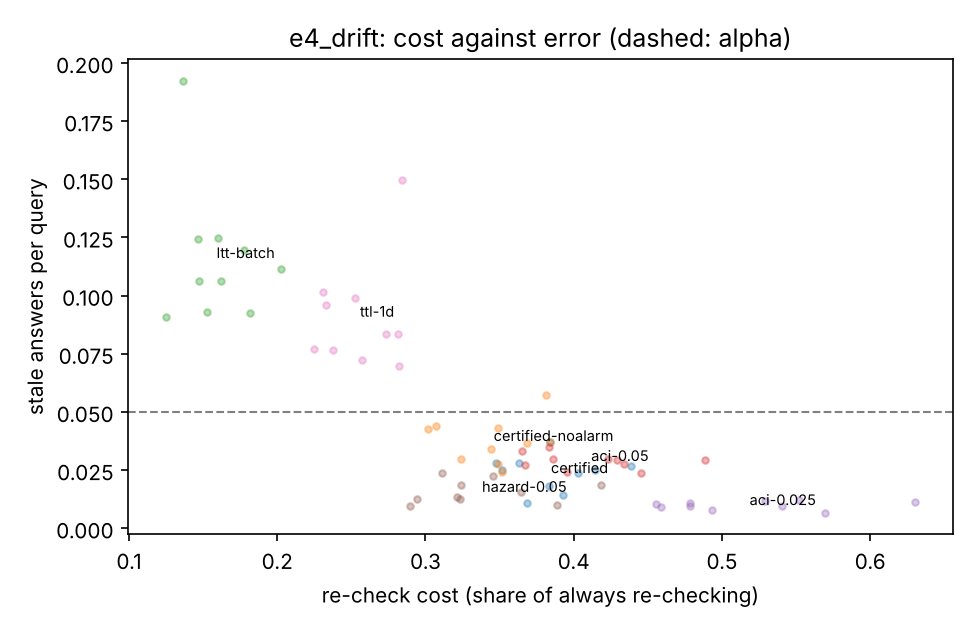
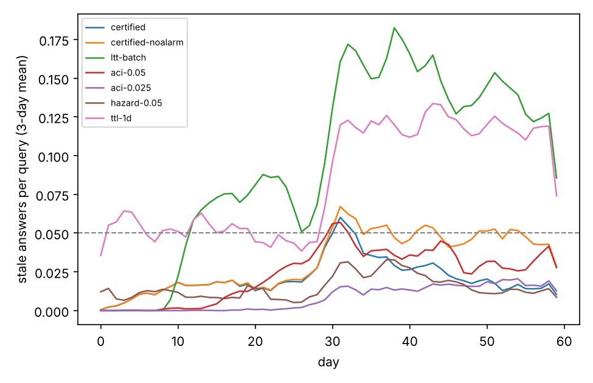

# e4_drift

70 runs. Errors are stale or wrong answers per query after the burn-in; cost is re-checks as a share of always re-checking.

| Arm | Seeds | Error (mean) | Error (95th pct) | Seeds over alpha | Seeds with a group over alpha | Cost vs always | Served from memory |
|---|---|---|---|---|---|---|---|
| certified | 10 | 0.0237 | 0.0330 | 0.00 | 0.00 | 0.385 | 0.617 |
| certified-noalarm | 10 | 0.0375 | 0.0513 | 0.10 | 0.40 | 0.346 | 0.669 |
| ltt-batch | 10 | 0.1161 | 0.1619 | 1.00 | 1.00 | 0.159 | 0.848 |
| aci-0.05 | 10 | 0.0289 | 0.0341 | 0.00 | 0.00 | 0.412 | 0.607 |
| aci-0.025 | 10 | 0.0099 | 0.0120 | 0.00 | 0.00 | 0.519 | 0.470 |
| hazard-0.05 | 10 | 0.0156 | 0.0229 | 0.00 | 0.00 | 0.338 | 0.645 |
| ttl-1d | 10 | 0.0909 | 0.1281 | 1.00 | 1.00 | 0.256 | 0.753 |

Error by provenance class (mean over seeds):

| Arm | delegated | inferred | notified | observed | stated |
|---|---|---|---|---|---|
| certified | 0.0063 | 0.0088 | 0.0004 | 0.0286 | 0.0005 |
| certified-noalarm | 0.0062 | 0.0081 | 0.0004 | 0.0464 | 0.0005 |
| ltt-batch | 0.1234 | 0.1130 | 0.1477 | 0.1351 | 0.0774 |
| aci-0.05 | 0.0000 | 0.0001 | 0.0000 | 0.0364 | 0.0000 |
| aci-0.025 | 0.0000 | 0.0000 | 0.0000 | 0.0125 | 0.0000 |
| hazard-0.05 | 0.0157 | 0.0074 | 0.0045 | 0.0201 | 0.0059 |
| ttl-1d | 0.0456 | 0.1709 | 0.2916 | 0.0761 | 0.0020 |

By time window (error mean / seeds with a group over alpha / cost):

| Arm | before_drift | after_drift | last_two_weeks |
|---|---|---|---|
| certified | 0.0184 / 0.00 / 0.357 | 0.0272 / 0.10 / 0.403 | 0.0167 / 0.10 / 0.403 |
| certified-noalarm | 0.0187 / 0.00 / 0.352 | 0.0499 / 0.70 / 0.342 | 0.0464 / 0.60 / 0.342 |
| ltt-batch | 0.0684 / 1.00 / 0.156 | 0.1479 / 1.00 / 0.161 | 0.1344 / 1.00 / 0.169 |
| aci-0.05 | 0.0173 / 0.00 / 0.422 | 0.0366 / 0.30 / 0.405 | 0.0305 / 0.10 / 0.404 |
| aci-0.025 | 0.0012 / 0.00 / 0.624 | 0.0157 / 0.00 / 0.449 | 0.0178 / 0.40 / 0.437 |
| hazard-0.05 | 0.0092 / 0.10 / 0.331 | 0.0199 / 0.10 / 0.343 | 0.0132 / 0.10 / 0.348 |
| ttl-1d | 0.0482 / 1.00 / 0.255 | 0.1193 / 1.00 / 0.257 | 0.1171 / 1.00 / 0.256 |

Certification by group (share of seeds certified / median day of first certificate / alarms per run):

| Arm | delegated | inferred | notified | observed | stated |
|---|---|---|---|---|---|
| certified | 1.00 / 29.3 / 0.0 | 1.00 / 5.9 / 0.0 | 1.00 / 46.7 / 0.0 | 1.00 / 1.0 / 0.9 | 1.00 / 50.3 / 0.0 |
| certified-noalarm | 1.00 / 29.3 / 0.0 | 1.00 / 5.9 / 0.0 | 1.00 / 46.5 / 0.0 | 1.00 / 1.0 / 0.0 | 1.00 / 50.6 / 0.0 |

