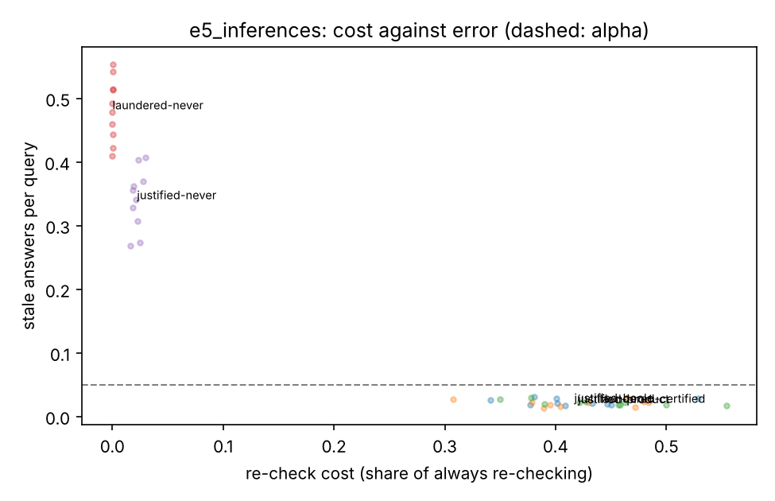
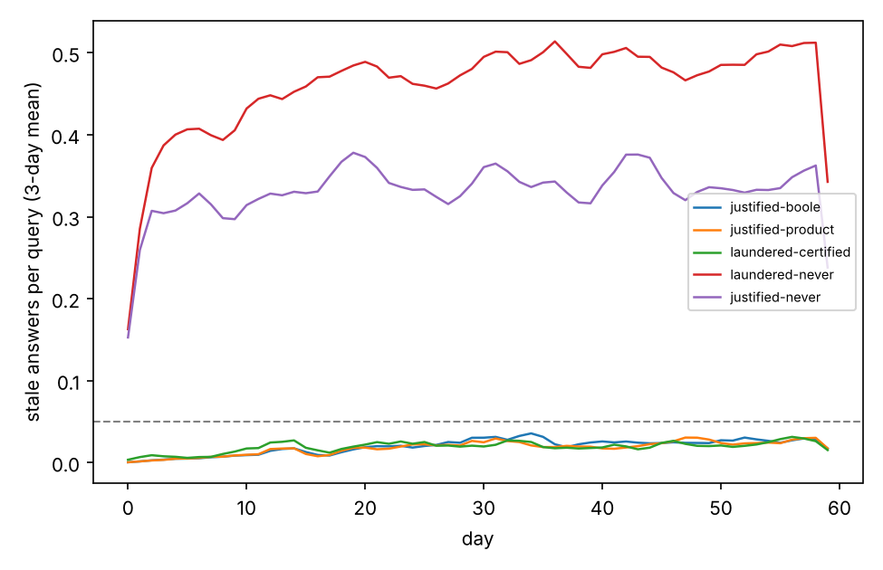

# e5_inferences

50 runs. Errors are stale or wrong answers per query after the burn-in; cost is re-checks as a share of always re-checking.

| Arm | Seeds | Error (mean) | Error (95th pct) | Seeds over alpha | Seeds with a group over alpha | Cost vs always | Served from memory |
|---|---|---|---|---|---|---|---|
| justified-boole | 10 | 0.0226 | 0.0296 | 0.00 | 0.00 | 0.417 | 0.611 |
| justified-product | 10 | 0.0208 | 0.0284 | 0.00 | 0.00 | 0.420 | 0.610 |
| laundered-certified | 10 | 0.0215 | 0.0288 | 0.00 | 0.00 | 0.440 | 0.579 |
| laundered-never | 10 | 0.4827 | 0.5481 | 1.00 | 1.00 | 0.000 | 1.000 |
| justified-never | 10 | 0.3414 | 0.4053 | 1.00 | 1.00 | 0.022 | 0.984 |

Error by provenance class (mean over seeds):

| Arm | delegated | inferred | notified | observed | stated |
|---|---|---|---|---|---|
| justified-boole | 0.0032 | 0.0165 | 0.0000 | 0.0295 | 0.0000 |
| justified-product | 0.0026 | 0.0141 | 0.0000 | 0.0279 | 0.0000 |
| laundered-certified | 0.0034 | 0.0000 | 0.0000 | 0.0225 | 0.0034 |
| laundered-never | 0.3538 | 0.0000 | 0.4198 | 0.7559 | 0.0769 |
| justified-never | 0.3432 | 0.4468 | 0.4201 | 0.3337 | 0.0779 |

Certification by group (share of seeds certified / median day of first certificate / alarms per run):

| Arm | delegated | inferred | notified | observed | stated |
|---|---|---|---|---|---|
| justified-boole | 1.00 / 31.4 / 0.0 | 1.00 / 2.1 / 0.3 | 0.00 / - / 0.0 | 1.00 / 1.4 / 0.3 | 0.90 / 56.3 / 0.0 |
| justified-product | 1.00 / 31.4 / 0.0 | 1.00 / 2.1 / 0.1 | 0.00 / - / 0.0 | 1.00 / 1.4 / 0.2 | 0.80 / 54.8 / 0.0 |
| laundered-certified | 1.00 / 32.4 / 0.0 | 0.00 / - / 0.0 | 0.00 / - / 0.0 | 1.00 / 0.9 / 0.7 | 0.80 / 55.3 / 0.0 |

