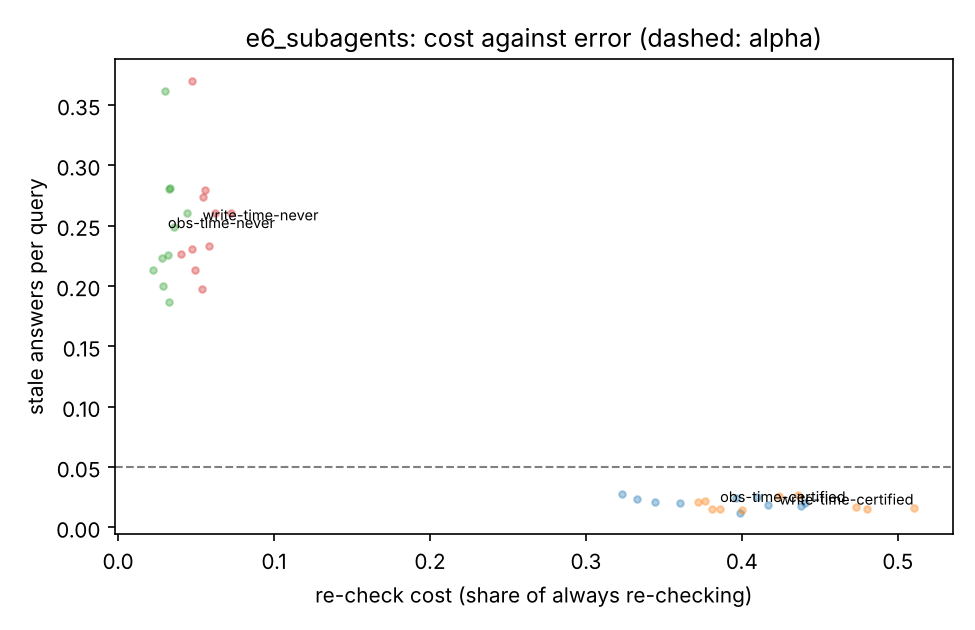
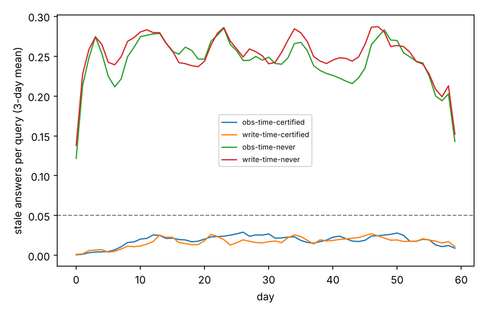

# e6_subagents

40 runs. Errors are stale or wrong answers per query after the burn-in; cost is re-checks as a share of always re-checking.

| Arm | Seeds | Error (mean) | Error (95th pct) | Seeds over alpha | Seeds with a group over alpha | Cost vs always | Served from memory |
|---|---|---|---|---|---|---|---|
| obs-time-certified | 10 | 0.0211 | 0.0266 | 0.00 | 0.00 | 0.386 | 0.656 |
| write-time-certified | 10 | 0.0189 | 0.0264 | 0.00 | 0.00 | 0.424 | 0.611 |
| obs-time-never | 10 | 0.2481 | 0.3255 | 1.00 | 1.00 | 0.032 | 0.982 |
| write-time-never | 10 | 0.2545 | 0.3295 | 1.00 | 1.00 | 0.054 | 0.969 |

Error by provenance class (mean over seeds):

| Arm | delegated | inferred | notified | observed | stated |
|---|---|---|---|---|---|
| obs-time-certified | 0.0068 | 0.0090 | 0.0000 | 0.0256 | 0.0005 |
| write-time-certified | 0.0131 | 0.0055 | 0.0000 | 0.0240 | 0.0009 |
| obs-time-never | 0.2702 | 0.3775 | 0.3339 | 0.2234 | 0.0896 |
| write-time-never | 0.3152 | 0.3311 | 0.2404 | 0.1287 | 0.1014 |

Certification by group (share of seeds certified / median day of first certificate / alarms per run):

| Arm | delegated | inferred | notified | observed | stated |
|---|---|---|---|---|---|
| obs-time-certified | 1.00 / 16.8 / 0.0 | 1.00 / 6.0 / 0.0 | 0.00 / - / 0.0 | 1.00 / 1.0 / 0.9 | 1.00 / 50.7 / 0.0 |
| write-time-certified | 1.00 / 6.0 / 0.2 | 1.00 / 6.6 / 0.0 | 0.00 / - / 0.0 | 1.00 / 1.0 / 0.5 | 0.80 / 56.1 / 0.0 |

