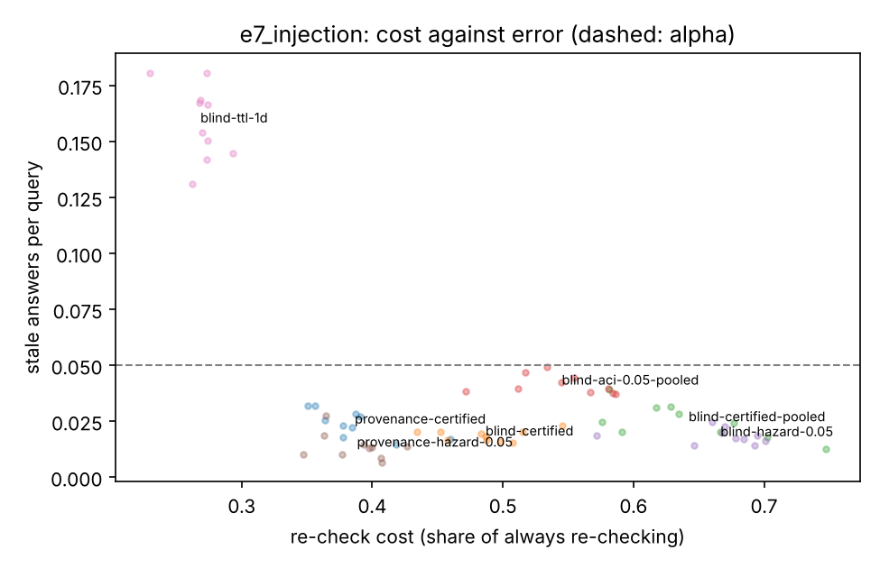
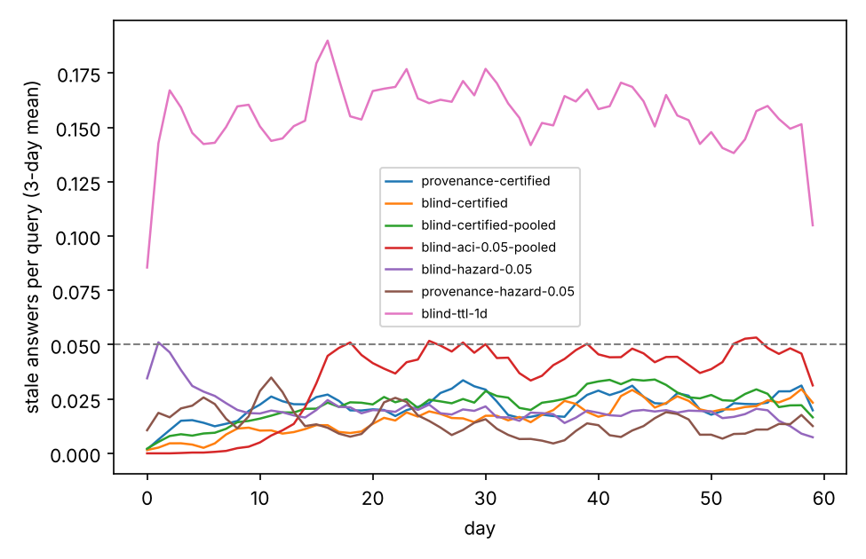

# e7_injection

70 runs. Errors are stale or wrong answers per query after the burn-in; cost is re-checks as a share of always re-checking.

| Arm | Seeds | Error (mean) | Error (95th pct) | Seeds over alpha | Seeds with a group over alpha | Cost vs always | Served from memory |
|---|---|---|---|---|---|---|---|
| provenance-certified | 10 | 0.0240 | 0.0318 | 0.00 | 0.00 | 0.387 | 0.652 |
| blind-certified | 10 | 0.0186 | 0.0219 | 0.00 | 0.00 | 0.487 | 0.579 |
| blind-certified-pooled | 10 | 0.0250 | 0.0358 | 0.00 | 1.00 | 0.642 | 0.403 |
| blind-aci-0.05-pooled | 10 | 0.0414 | 0.0482 | 0.00 | 1.00 | 0.545 | 0.503 |
| blind-hazard-0.05 | 10 | 0.0183 | 0.0238 | 0.00 | 1.00 | 0.667 | 0.380 |
| provenance-hazard-0.05 | 10 | 0.0137 | 0.0236 | 0.00 | 0.40 | 0.388 | 0.637 |
| blind-ttl-1d | 10 | 0.1585 | 0.1805 | 1.00 | 1.00 | 0.268 | 0.772 |

Error by provenance class (mean over seeds):

| Arm | delegated | inferred | notified | observed | stated |
|---|---|---|---|---|---|
| provenance-certified | 0.0051 | 0.0086 | 0.0000 | 0.0287 | 0.0029 |
| blind-certified | 0.0021 | 0.0041 | 0.0000 | 0.0237 | 0.0058 |
| blind-certified-pooled | 0.0000 | 0.0014 | 0.0051 | 0.0043 | 0.2028 |
| blind-aci-0.05-pooled | 0.0000 | 0.0057 | 0.0103 | 0.0088 | 0.2874 |
| blind-hazard-0.05 | 0.0000 | 0.0003 | 0.0012 | 0.0025 | 0.1627 |
| provenance-hazard-0.05 | 0.0251 | 0.0051 | 0.0068 | 0.0127 | 0.0222 |
| blind-ttl-1d | 0.0315 | 0.1151 | 0.0583 | 0.0575 | 0.5211 |

Certification by group (share of seeds certified / median day of first certificate / alarms per run):

| Arm | all | delegated | inferred | notified | observed | stated |
|---|---|---|---|---|---|---|
| provenance-certified |  | 1.00 / 29.2 / 0.0 | 1.00 / 6.1 / 0.0 | 0.00 / - / 0.0 | 1.00 / 1.0 / 0.6 | 1.00 / 51.5 / 0.0 |
| blind-certified |  | 1.00 / 50.2 / 0.0 | 1.00 / 6.9 / 0.0 | 0.00 / - / 0.0 | 1.00 / 1.0 / 0.1 | 1.00 / 9.2 / 0.0 |
| blind-certified-pooled | 1.00 / 0.7 / 0.9 |  |  |  |  |  |

