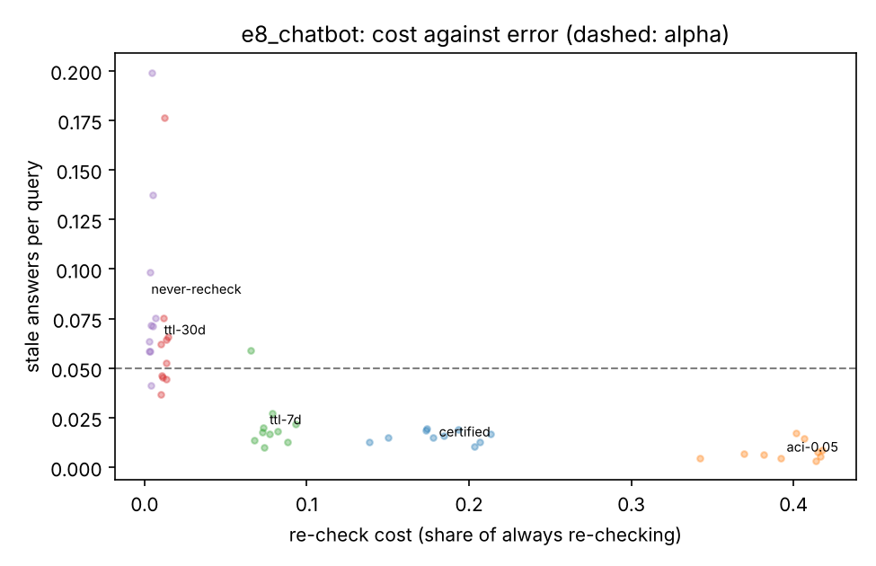
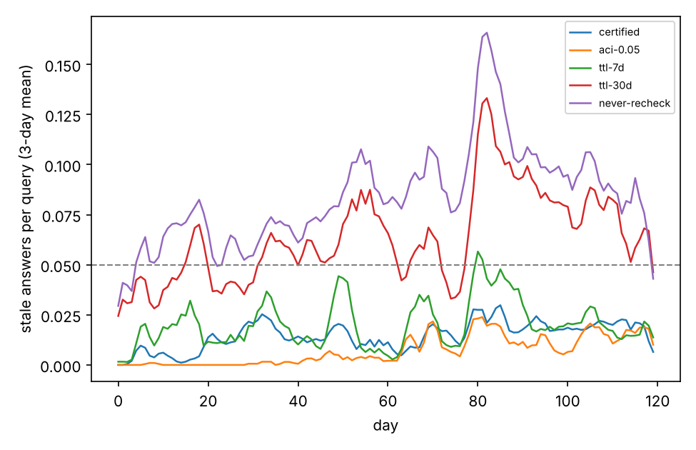

# e8_chatbot

50 runs. Errors are stale or wrong answers per query after the burn-in; cost is re-checks as a share of always re-checking.

| Arm | Seeds | Error (mean) | Error (95th pct) | Seeds over alpha | Seeds with a group over alpha | Cost vs always | Served from memory |
|---|---|---|---|---|---|---|---|
| certified | 10 | 0.0156 | 0.0193 | 0.00 | 0.00 | 0.181 | 0.832 |
| aci-0.05 | 10 | 0.0079 | 0.0161 | 0.00 | 0.00 | 0.396 | 0.648 |
| ttl-7d | 10 | 0.0217 | 0.0447 | 0.10 | 0.10 | 0.077 | 0.936 |
| ttl-30d | 10 | 0.0670 | 0.1308 | 0.60 | 0.90 | 0.012 | 0.990 |
| never-recheck | 10 | 0.0875 | 0.1712 | 0.90 | 1.00 | 0.004 | 0.997 |

Error by provenance class (mean over seeds):

| Arm | inferred | observed | stated |
|---|---|---|---|
| certified | 0.0154 | 0.0165 | 0.0049 |
| aci-0.05 | 0.0000 | 0.0097 | 0.0000 |
| ttl-7d | 0.0274 | 0.0189 | 0.0256 |
| ttl-30d | 0.0926 | 0.0539 | 0.0683 |
| never-recheck | 0.1222 | 0.0475 | 0.0885 |

Certification by group (share of seeds certified / median day of first certificate / alarms per run):

| Arm | delegated | inferred | notified | observed | stated |
|---|---|---|---|---|---|
| certified | 0.00 / - / 0.0 | 1.00 / 17.1 / 0.0 | 0.00 / - / 0.0 | 1.00 / 3.2 / 0.1 | 1.00 / 64.5 / 0.0 |

